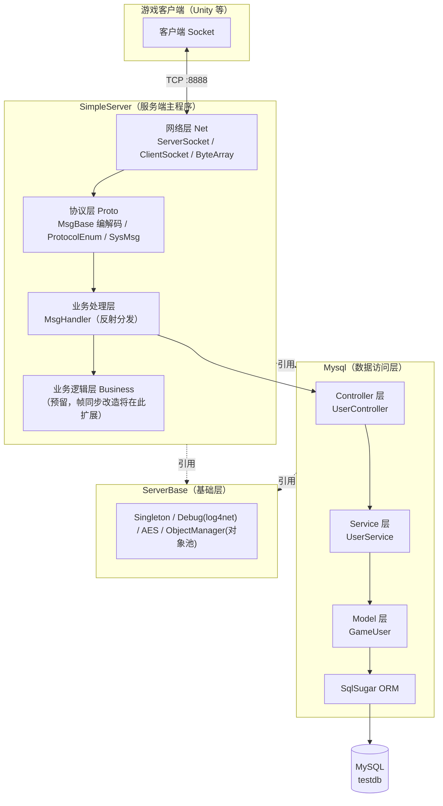

# ServerDemo 项目技术说明

> 本文档面向刚接触服务端开发的读者，全面说明 `ServerDemo` 项目的架构、现有模块功能、环境搭建与运行启动方式。

---

## 目录

1. [项目概述](#1-项目概述)
2. [技术栈与依赖](#2-技术栈与依赖)
3. [项目架构说明](#3-项目架构说明)
4. [现有模块功能介绍](#4-现有模块功能介绍)
5. [网络通信协议设计](#5-网络通信协议设计)
6. [环境搭建步骤](#6-环境搭建步骤)
7. [运行启动指南](#7-运行启动指南)
8. [目录结构](#8-目录结构)
9. [配置项汇总](#9-配置项汇总)

---

## 1. 项目概述

`ServerDemo` 是一个用于**学习游戏服务端开发**的 C#/.NET 示例项目，当前已实现一个**可运行的 TCP 游戏服务端**，具备：

- 基于 `System.Net.Sockets` 的 TCP 网络通信（`Socket.Select` 多路复用）
- 基于 `protobuf-net` 的消息序列化 + 基于 AES 的消息加密
- 基于反射的协议自动分发机制
- 心跳保活与超时断线检测
- 登录 / 注册业务，并通过 `SqlSugar` ORM 读写 MySQL 数据库
- 日志（log4net）、单例、对象池等基础工具

项目定位是**服务器骨架/教学示例**，后续将在此基础上进行「帧同步联机」功能改造（详见 [《帧同步改造操作手册.md》](帧同步改造操作手册.md)）。

---

## 2. 技术栈与依赖

| 类别 | 技术 | 版本 | 说明 |
| --- | --- | --- | --- |
| 运行时 | .NET | 8.0（`net8.0`） | 所有项目统一目标框架 |
| 语言 | C# | 12 | 使用 `ImplicitUsings`、`Nullable` |
| ORM | SqlSugarCore | 5.1.4.221 | 数据库访问 |
| 序列化 | protobuf-net | 3.4.30 | 消息体序列化/反序列化 |
| 日志 | log4net | 3.3.0 | 控制台 + 滚动文件日志 |
| 加密 | `System.Security.Cryptography` | 内置 | AES/Rijndael 加密 |
| 网络 | `System.Net.Sockets` | 内置 | TCP Socket |
| 数据库 | MySQL | 8.x | 本机 `testdb` 库 |

---

## 3. 项目架构说明

### 3.1 解决方案结构

解决方案文件为 `MyServerDeom.slnx`，包含 3 个项目（另外根目录下还有一个遗留的 `MyServerDeom/` 空项目，**未加入解决方案**，属于历史遗留的 Hello World 骨架，可忽略或删除）：

| 项目 | 类型 | 职责 |
| --- | --- | --- |
| `ServerBase` | 类库（基础层） | 通用工具：单例、日志、AES 加密、对象池 |
| `Mysql` | 类库（数据层） | 数据访问：ORM、Controller、Service、实体 |
| `SimpleServer` | 可执行程序（入口） | 网络层 + 协议层 + 业务处理，服务端主程序 |

**项目依赖关系（自底向上）：**

```
ServerBase（基础工具）
    ▲
    │ 被引用
    │
  Mysql（数据层） ──────── 引用 ServerBase
    ▲
    │ 被引用
    │
SimpleServer（网络/协议/业务入口） ── 引用 Mysql + ServerBase
```

对应 `.csproj` 中的引用关系：

- [Mysql.csproj](Mysql/Mysql.csproj) → `ProjectReference` 引用 `ServerBase`
- [SimpleServer.csproj](SimpleServer/SimpleServer.csproj) → 引用 `Mysql` + `ServerBase`

### 3.2 分层架构图



### 3.3 请求处理主流程

一次完整的「客户端请求 → 处理 → 响应」链路如下：

1. `ServerSocket.Init()` 启动监听，进入主循环。
2. `Socket.Select` 多路复用检测可读 Socket。
3. 客户端连接时 `ReadListen()` 建立 `ClientSocket` 并加入字典。
4. 收到数据后 `ReadClient()` 写入 `ByteArray` 缓冲区。
5. `OnReceiveData()` 解析数据包：读包头长度 → 读协议名 → AES 解密 + protobuf 反序列化为 `MsgBase` 子类。
6. 通过反射 `typeof(MsgHandler).GetMethod(协议名)` 找到对应处理方法并 `Invoke`。
7. 处理方法（如 `MsgLogin`）调用 `UserController`/`UserService` 访问数据库，再通过 `ServerSocket.Send()` 回包。

---

## 4. 现有模块功能介绍

### 4.1 ServerBase（基础层）

| 文件 | 类/功能 | 说明 |
| --- | --- | --- |
| [Singleton.cs](ServerBase/Singleton.cs) | `Singleton<T>` | 泛型单例基类，`Instance` 延迟创建，非线程安全（学习用途） |
| [Debug.cs](ServerBase/Debug.cs) | `Debug` | 对 log4net 的封装，提供 `Log / LogInfo / LogWarn / LogError / LogFatle` |
| [AES.cs](ServerBase/AES.cs) | `AES` | AES/Rijndael 加密工具：字节数组加解密、文件加解密 |
| [ObjectManager.cs](ServerBase/ObjectManager.cs) | `ClassObjectPool<T>` / `ObjectManager` | 泛型类对象池，`Spawn`/`Recycle`；`GetOrCreateClassPool<T>` 获取/创建对象池 |
| [log4net.config](ServerBase/log4net.config) | — | 日志配置：控制台 + 按日期滚动文件（输出到 `log\`） |

> 说明：`ServerBase` 中的 `Singleton`、`Debug`、`AES`、`ObjectManager` 均声明在**全局命名空间**，因此 `Mysql` 和 `SimpleServer` 项目可直接引用，无需 `using`。

### 4.2 Mysql（数据访问层）

采用经典的 **Controller → Service → Model** 三层结构：

| 文件 | 类/功能 | 说明 |
| --- | --- | --- |
| [MysqlManager.cs](Mysql/MysqlManager.cs) | `MysqlManager : Singleton<MysqlManager>` | 初始化 `SqlSugarClient`，连接 `testdb`；启动时尝试移除 `user_item` 表外键 |
| [UserController.cs](Mysql/Controllers/UserController.cs) | `UserController : Singleton<UserController>` | 注册/登录入口，做输入合法性校验后委托给 Service |
| [UserService.cs](Mysql/Service/UserService.cs) | `UserService` | 注册（查重 + 插入）、登录（校验密码 + 更新最后登录时间） |
| [GameUser.cs](Mysql/Models/GameUser.cs) | `GameUser` | `game_user` 表实体（SqlSugar `SugarTable`/`SugarColumn` 特性） |

**业务规则：**

- 注册：用户名长度 4~16，不允许重名，成功后写入数据库。
- 登录：校验用户名/密码，成功则更新 `LastLoginTime` 并返回用户资料。
- 密码目前**明文存储**（遵循 `.github/copilot-instructions.md` 中「暂不引入密码加密/哈希」的约定，保持逻辑简单直观）。
- 返回枚举：`RegisterResultType`（`Success / UserNameExists / InvalidInput / defaultError`）、`LoginResultType`（`Success / UserNotFound / InvalidPassword / defaultError`）。

### 4.3 SimpleServer（网络层 + 协议层 + 业务处理）

#### 网络层（`SimpleServer/Net`）

| 文件 | 类/功能 | 说明 |
| --- | --- | --- |
| [ServerSocket.cs](SimpleServer/Net/ServerSocket.cs) | `ServerSocket : Singleton<ServerSocket>` | 核心网络类：监听、`Socket.Select` 多路复用、收发、心跳超时、反射分发 |
| [ClientSocket.cs](SimpleServer/Net/ClientSocket.cs) | `ClientSocket` | 单个客户端的连接状态：Socket、心跳时间、用户信息、接收缓冲区 |
| [ByteArray.cs](SimpleServer/Net/ByteArray.cs) | `ByteArray` | 自定义收发缓冲区：`readIndex/writeIndex`，支持扩容与数据搬移 |

关键机制：

- **监听/多路复用**：`Init()` 中 `Socket.Select` 每 1 秒轮询一次可读 Socket，单线程处理连接与数据。
- **心跳保活**：客户端发 `MsgPing`，服务端更新 `LastPingTime` 并回 `MsgPing`；超过 `30s × 4 = 120s` 未心跳则主动断开。
- **缓冲区**：`ByteArray` 维护读写指针，数据不足时搬移/扩容，避免粘包半包问题。

#### 协议层（`SimpleServer/Proto`）

| 文件 | 类/功能 | 说明 |
| --- | --- | --- |
| [MsgBase.cs](SimpleServer/Proto/MsgBase.cs) | `MsgBase` | 消息基类，负责协议名编解码、消息体 AES + protobuf 编解码 |
| [ProtocolEnum.cs](SimpleServer/Proto/ProtocolEnum.cs) | `ProtocolEnum` | 协议枚举（`MsgSecret/MsgPing/MsgTest/MsgLogin/MsgRegister`） |
| [SysMsg.cs](SimpleServer/Proto/SysMsg.cs) | 各消息类 | `MsgSecret/MsgPing/MsgTest/MsgLogin/MsgRegister/UserItem` |
| [MsgHandler.cs](SimpleServer/Proto/MsgHandler.cs) | `MsgHandler` | 静态处理方法，方法名与协议名对应，供反射分发 |

已实现协议：

| 协议 | 枚举值 | 方向 | 作用 |
| --- | --- | --- | --- |
| `MsgSecret` | 1 | 双向 | 交换密钥（用公钥 `abc123` 加密，返回 `SecretKey`） |
| `MsgPing` | 2 | 双向 | 心跳保活 |
| `MsgTest` | 3 | 双向 | 测试回显 |
| `MsgLogin` | 4 | C→S→C | 登录 |
| `MsgRegister` | 5 | C→S→C | 注册 |

#### 业务层（`SimpleServer/Business`）

该目录当前**为空**，是专门为后续「帧同步」等业务逻辑预留的扩展位置。帧同步改造的 `GameRoom`、`FrameSyncManager`、`InputQueue` 等都将放在此目录，实现「网络通信」与「业务逻辑」分离。

---

## 5. 网络通信协议设计

### 5.1 数据包格式

每个数据包由「包头 + 协议名 + 协议体」三部分组成：

```
┌──────────────┬────────────────┬──────────────────────────────┐
│ 包头(4字节)   │ 协议名(变长)     │ 协议体(变长)                 │
│ 总长度 int32  │ 2字节名长+UTF8名 │ AES加密 + protobuf序列化      │
└──────────────┴────────────────┴──────────────────────────────┘
```

- **包头**：`BitConverter.GetBytes(len)`，`len = 协议名字节数 + 协议体字节数`（小端 int32）。
- **协议名**：前 2 字节为名字长度（`Int16` 小端），后接 UTF-8 编码的枚举名字符串。
- **协议体**：先 protobuf 序列化，再 AES 加密。

### 5.2 编码 / 解码流程

**编码（发送，`MsgBase.Encode` + `ServerSocket.Send`）**

1. `EncodeName()` 将协议名写入 `[2字节长度][名字]`。
2. `Encode()` 将消息对象 protobuf 序列化 → AES 加密。
3. `Send()` 拼接 `[4字节总长][协议名][协议体]` 后 `BeginSend` 发送。

**解码（接收，`ServerSocket.OnReceiveData`）**

1. 读 4 字节包头得 `bodylenth`。
2. `DecodeName()` 读协议名，得 `namecount` 与 `ProtocolEnum`。
3. `bodyCount = bodylenth - namecount`，`Decode()` 做 AES 解密 + protobuf 反序列化。
4. 反射找到 `MsgHandler` 中同名静态方法并调用。

### 5.3 加密机制

- 使用 AES（`Rijndael`）+ `PasswordDeriveBytes` 密钥派生，固定 IV 与盐值。
- 默认用 `SecretKey = "123456"` 加密；`MsgSecret` 消息用 `PublicKey = "abc123"` 加密。
- 密钥交换流程：客户端先用公钥加密 `MsgSecret` 请求 → 服务端返回 `SecretKey` → 之后用 `SecretKey` 通信。

### 5.4 心跳机制

- 服务端每轮主循环计算 `当前时间 - LastPingTime`，超过 `30s × 4` 判定超时。
- 超时客户端被收集到 `m_HeartBeatTimeoutList`，统一调用 `CloseClient()` 关闭。
- 「检查」与「删除」分离，避免在遍历字典时修改集合。

---

## 6. 环境搭建步骤

### 6.1 前置要求

| 软件 | 版本要求 | 说明 |
| --- | --- | --- |
| .NET SDK | 8.0 或更高 | `dotnet --version` 验证 |
| MySQL | 8.x | 本机运行，端口 3306 |
| IDE（可选） | Visual Studio 2022 / Rider / VS Code | 打开 `.slnx` 需要 VS 2022 17.13+ 或 .NET 9 SDK 及以上 |

验证 .NET：

```powershell
dotnet --version
# 输出例如 8.0.xxx
```

### 6.2 数据库初始化

服务端连接串（见 [MysqlManager.cs](Mysql/MysqlManager.cs)）：

```
server=127.0.0.1;port=3306;uid=root;pwd=admin123;database=testdb;SslMode=None
```

请确保 MySQL 中 `root` 密码为 `admin123`，并创建 `testdb` 数据库与 `game_user` 表：

```sql
CREATE DATABASE IF NOT EXISTS testdb DEFAULT CHARACTER SET utf8mb4;
USE testdb;

CREATE TABLE IF NOT EXISTS `game_user` (
  `id`              BIGINT       NOT NULL AUTO_INCREMENT,
  `username`        VARCHAR(64)  NOT NULL,
  `password`        VARCHAR(128) NOT NULL,
  `nickname`        VARCHAR(64)  NULL,
  `level`           INT          NOT NULL DEFAULT 1,
  `create_time`     DATETIME     NOT NULL DEFAULT CURRENT_TIMESTAMP,
  `last_login_time` DATETIME     NULL,
  `is_active`       INT          NOT NULL DEFAULT 1,
  PRIMARY KEY (`id`),
  UNIQUE KEY `uk_username` (`username`)
) ENGINE=InnoDB DEFAULT CHARSET=utf8mb4;
```

> `user_item` 表：`MysqlManager` 启动时会尝试删除 `user_item` 的外键 `user_item_ibfk_2` / `fk_itemid`。若该表不存在，会捕获异常并跳过（日志提示），**不影响登录/注册功能**。物品数据由 Unity 客户端本地维护（见 [RemoveItemTemplateForeignKey.sql](RemoveItemTemplateForeignKey.sql)）。

### 6.3 配置说明

| 配置项 | 位置 | 默认值 | 说明 |
| --- | --- | --- | --- |
| 服务端 IP | `ServerSocket.m_IP` | `127.0.0.1` | 监听地址 |
| 服务端端口 | `ServerSocket.m_Port` | `8888` | 监听端口 |
| 公钥 | `ServerSocket.PublicKey` | `abc123` | `MsgSecret` 加密用 |
| 私钥 | `ServerSocket.SecretKey` | `123456` | 常规消息加密用 |
| 心跳间隔 | `ServerSocket.m_HeartBeatInterval` | 30 秒 | 超时判定 = 间隔 × 4 |
| 数据库连接串 | `MysqlManager.Init()` | 见 6.2 | MySQL 连接 |

---

## 7. 运行启动指南

### 7.1 编译

在项目根目录执行：

```powershell
dotnet build SimpleServer/SimpleServer.csproj
```

> 说明：`MyServerDeom.slnx` 是 .NET 9 引入的新版解决方案格式，若 `dotnet build MyServerDeom.slnx` 提示格式不支持，请直接对 `SimpleServer.csproj` 编译，或升级 .NET SDK。

### 7.2 启动服务端

```powershell
dotnet run --project SimpleServer/SimpleServer.csproj
```

启动成功后，控制台会输出数据库连接与日志信息，服务端开始监听 `127.0.0.1:8888`。

### 7.3 客户端连接测试

客户端（Unity 或任意 TCP 调试工具）需要按 [5.1 数据包格式](#51-数据包格式) 收发消息。最小测试流程：

1. 连接 `127.0.0.1:8888`。
2. 用公钥 `abc123` 加密发送 `MsgSecret` 请求。
3. 收到服务端返回的 `SecretKey` 后，后续消息用该密钥加密。
4. 发送 `MsgRegister` / `MsgLogin` 测试注册登录。
5. 定期发送 `MsgPing` 保持心跳。

> 由于服务端对消息体做了 AES 加密 + protobuf 序列化，直接使用 telnet 等工具无法完成协议测试；建议使用 Unity 客户端，或编写一个遵循相同编解码逻辑的 C# 测试客户端。

### 7.4 常见问题

| 现象 | 原因与解决 |
| --- | --- |
| 启动报「8888 已被占用」 | 已有一个服务端实例在运行，关闭旧的 `SimpleServer.exe` 后重试 |
| 数据库连接失败 | 检查 MySQL 是否启动、`root` 密码是否为 `admin123`、`testdb` 库与 `game_user` 表是否已创建 |
| 客户端收不到响应 | 确认加密密钥（公钥/私钥）与编码格式一致，协议名字符串与 `ProtocolEnum` 完全匹配 |
| `.slnx` 打不开 | 升级 VS 2022 到 17.13+，或改用 `dotnet` 直接构建 `.csproj` |

---

## 8. 目录结构

```
MyServerDeom/
├── MyServerDeom.slnx                  # 解决方案（3 个项目）
├── ServerBase/                        # 基础层（工具类库）
│   ├── Singleton.cs                   #   泛型单例
│   ├── Debug.cs                       #   日志封装
│   ├── AES.cs                         #   AES 加解密
│   ├── ObjectManager.cs               #   对象池
│   ├── log4net.config                 #   日志配置
│   └── Properties/AssemblyInfo.cs
├── Mysql/                             # 数据访问层
│   ├── MysqlManager.cs                #   SqlSugar 初始化
│   ├── Controllers/UserController.cs  #   控制器
│   ├── Service/UserService.cs         #   业务逻辑
│   ├── Models/GameUser.cs             #   实体
│   └── Mysql.csproj
├── SimpleServer/                      # 服务端主程序
│   ├── Program.cs                     #   入口
│   ├── Net/                           #   网络层
│   │   ├── ServerSocket.cs
│   │   ├── ClientSocket.cs
│   │   └── ByteArray.cs
│   ├── Proto/                         #   协议层
│   │   ├── MsgBase.cs
│   │   ├── ProtocolEnum.cs
│   │   ├── SysMsg.cs
│   │   └── MsgHandler.cs
│   ├── Business/                      #   业务层（预留，空）
│   └── SimpleServer.csproj
├── MyServerDeom/                      # 遗留 Hello World 项目（未加入解决方案）
├── RemoveItemTemplateForeignKey.sql   # 外键处理脚本
└── .github/copilot-instructions.md
```

---

## 9. 配置项汇总

| 类别 | 配置项 | 默认值 | 所属文件 |
| --- | --- | --- | --- |
| 网络 | 监听 IP | `127.0.0.1` | `SimpleServer/Net/ServerSocket.cs` |
| 网络 | 监听端口 | `8888` | `SimpleServer/Net/ServerSocket.cs` |
| 加密 | 公钥 | `abc123` | `SimpleServer/Net/ServerSocket.cs` |
| 加密 | 私钥 | `123456` | `SimpleServer/Net/ServerSocket.cs` |
| 心跳 | 心跳间隔 | 30 秒 | `SimpleServer/Net/ServerSocket.cs` |
| 数据库 | 连接串 | `127.0.0.1:3306 root/admin123 testdb` | `Mysql/MysqlManager.cs` |
| 日志 | 日志目录/滚动策略 | `log\`，按日期 | `ServerBase/log4net.config` |

---

## 相关文档

- 后续帧同步联机功能改造，请阅读 [《帧同步改造操作手册.md》](帧同步改造操作手册.md)。
