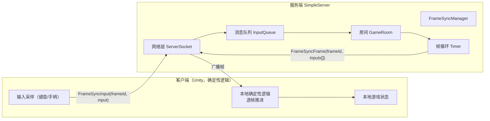

# 帧同步功能改造操作手册

> 本文档基于当前 `ServerDemo` 服务端框架，手把手引导完成「帧同步（锁步 Lockstep）联机功能」的改造。
> 每一步都标注了**修改文件位置、具体代码、修改逻辑说明、验证方法/测试标准、注意事项与坑点**。
> 按照文档顺序操作，即可在现有框架上实现一套可运行、可验证的帧同步联机功能。

---

## 目录

1. [改造目标与总体设计](#1-改造目标与总体设计)
2. [协议选型专题：TCP vs UDP](#2-协议选型专题tcp-vs-udp)
3. [改造步骤总览](#3-改造步骤总览)
4. [步骤 0：改造准备与目录规划](#4-步骤-0改造准备与目录规划)
5. [步骤 1：扩展协议枚举与消息定义](#5-步骤-1扩展协议枚举与消息定义)
6. [步骤 2：帧同步核心数据结构](#6-步骤-2帧同步核心数据结构)
7. [步骤 3：消息队列模块（InputQueue）](#7-步骤-3消息队列模块inputqueue)
8. [步骤 4：房间与帧循环（GameRoom）](#8-步骤-4房间与帧循环gameroom)
9. [步骤 5：房间管理器（FrameSyncManager）](#9-步骤-5房间管理器framesycmanager)
10. [步骤 6：帧同步业务处理（FrameSyncHandler）](#10-步骤-6帧同步业务处理framesycchandler)
11. [步骤 7：接入协议分发（ServerSocket 改造）](#11-步骤-7接入协议分发serversocket-改造)
12. [步骤 8：客户端-服务端时序对齐](#12-步骤-8客户端-服务端时序对齐)
13. [步骤 9：断线重连逻辑](#13-步骤-9断线重连逻辑)
14. [步骤 10：帧数据校验机制](#14-步骤-10帧数据校验机制)
15. [整体验收测试清单](#15-整体验收测试清单)
16. [常见坑点汇总](#16-常见坑点汇总)
17. [性能优化要点](#17-性能优化要点)

---

## 1. 改造目标与总体设计

### 1.1 什么是帧同步（锁步）

帧同步（Lockstep）是实时对战类游戏（RTS、MOBA、回合制、部分格斗游戏）常用的联机同步方案：

- 客户端**不互相发送游戏状态**，只发送**玩家输入指令**。
- 服务器以固定频率推进「逻辑帧」，收集所有玩家的输入，组装成「帧」后广播给所有人。
- 每个客户端拿到同一帧的全部输入，用**同一套确定性逻辑**本地计算，得到一致的游戏状态。

> 关键前提：客户端逻辑必须**确定性（Deterministic）**——同样的输入序列，任何机器、任何时刻重放，结果完全一致（避免使用浮点随机数、依赖机器时钟、集合遍历顺序不确定等）。

### 1.2 改造目标

在现有 TCP 服务端上新增：

- 房间（Room）与座位（Player Slot）管理
- 输入消息队列（按帧号聚合）
- 固定频率帧循环，收集输入并广播帧
- 客户端-服务端时序对齐
- 断线重连与历史帧补发
- 帧数据校验（Checksum）

### 1.3 总体架构



---

## 2. 协议选型专题：TCP vs UDP

### 2.1 结论（先说答案）

> **本阶段不需要把现有协议改为 UDP。** 帧同步（严格锁步）的核心诉求是「所有玩家的输入按帧序、可靠、不丢不重地到达」，现有 TCP 恰好满足，直接沿用即可。改造的重点是**在 TCP 之上实现帧同步的逻辑层**，而不是更换传输协议。

同时建议**预留传输层抽象**，为后续引入 UDP（回滚帧同步 / 快节奏动作游戏）留出扩展点。

### 2.2 帧同步对传输层的要求

| 需求 | 说明 |
| --- | --- |
| 可靠性 | 任一输入丢失会导致所有客户端状态分叉（desync），必须可靠 |
| 有序性 | 输入必须按帧号/发送顺序到达，否则逻辑顺序错乱 |
| 低延迟 | 延迟越高，帧间隔被迫拉大，手感越差 |
| 广播 | 服务端要把同一帧广播给所有玩家 |

### 2.3 TCP vs UDP 对比

| 维度 | TCP | UDP |
| --- | --- | --- |
| 连接 | 面向连接，三次握手 | 无连接 |
| 可靠性 | 可靠（重传、确认、有序） | 不可靠（丢包、乱序、重复） |
| 顺序 | 保证有序 | 不保证 |
| 头部开销 | 较大（20 字节起） | 小（8 字节） |
| 延迟 | 较高（队头阻塞 HOL） | 较低 |
| 流式 | 字节流，需处理粘包/半包 | 数据报，天然分包 |
| 适用场景 | 回合制、RTS 锁步、需要可靠传输的场合 | FPS、格斗、实时性优先的场合 |
| 实现复杂度（帧同步） | 低（直接用） | 高（需自实现可靠层/排序/去重/重传） |

**TCP 的主要缺点——队头阻塞（Head-of-Line Blocking）**：TCP 保证字节流有序，前面一个报文丢失，后面的报文即使已到达也无法上交应用层，必须等重传。对高实时帧同步（如 60fps 格斗）影响明显；但对本项目 10~20fps 逻辑帧、双人对战的教学场景，影响可忽略。

**UDP 用于帧同步的两种思路**：

1. **回滚帧同步（Rollback，GGPO 风格）**：允许预测执行，收到对手输入后回滚重算。需要 UDP + 自己处理可靠性/顺序，实现复杂。
2. **可靠 UDP（RUDP）**：在 UDP 上自实现确认、重传、排序、去重，等价于「定制版 TCP」，仅在需要更细粒度控制时使用。

### 2.4 最终选型依据

- **当前阶段选 TCP**：① 现有框架就是 TCP，改动最小；② 锁步要求可靠有序，TCP 原生满足；③ 学习阶段优先把「帧同步逻辑」做对，而非陷入传输层可靠性实现；④ 双人/少数人 + 10~20fps 逻辑帧，TCP 延迟完全可接受。
- **未来切换 UDP 的时机**：当逻辑帧率提高到 30fps 以上、或需要预测回滚抵消高延迟、或对队头阻塞敏感时，引入传输抽象层替换底层为 UDP（可靠层可选 KCP 等）。

---

## 3. 改造步骤总览

| 步骤 | 主题 | 涉及文件 | 产出 |
| --- | --- | --- | --- |
| 0 | 改造准备与目录规划 | `Business/` | 明确新增文件与目录 |
| 1 | 扩展协议枚举与消息定义 | `Proto/ProtocolEnum.cs`、`Proto/FrameSyncMsg.cs`（新） | 帧同步协议与消息 |
| 2 | 帧同步核心数据结构 | `Business/FrameSyncTypes.cs`（新） | `FrameData`/`FramePlayer`/配置 |
| 3 | 消息队列模块 | `Business/InputQueue.cs`（新） | 按帧号聚合输入 |
| 4 | 房间与帧循环 | `Business/GameRoom.cs`（新） | 房间管理 + 定时帧循环 |
| 5 | 房间管理器 | `Business/FrameSyncManager.cs`（新） | 房间注册表 + 校验 |
| 6 | 帧同步业务处理 | `Business/FrameSyncHandler.cs`（新） | 协议处理方法 |
| 7 | 接入协议分发 | `Net/ServerSocket.cs` | 反射分发扩展 |
| 8 | 时序对齐 | 文档 + 客户端契约 | 时钟同步方案 |
| 9 | 断线重连 | `FrameSyncManager`/`ServerSocket`/`GameRoom` | 重连与补帧 |
| 10 | 帧数据校验 | `FrameSyncManager`/`GameRoom` | Checksum |

> 建议每完成一步就执行对应「验证方法」，不要全部写完再测，便于快速定位问题。

---

## 4. 步骤 0：改造准备与目录规划

### 4.1 修改说明

本改造**全部在 `SimpleServer` 项目内完成**，新增目录 `SimpleServer/Business/`（当前为空，正好作为业务逻辑层），并新增 1 个协议文件。

- 新增：`SimpleServer/Proto/FrameSyncMsg.cs`
- 新增：`SimpleServer/Business/FrameSyncTypes.cs`
- 新增：`SimpleServer/Business/InputQueue.cs`
- 新增：`SimpleServer/Business/GameRoom.cs`
- 新增：`SimpleServer/Business/FrameSyncManager.cs`
- 新增：`SimpleServer/Business/FrameSyncHandler.cs`
- 修改：`SimpleServer/Proto/ProtocolEnum.cs`
- 修改：`SimpleServer/Net/ServerSocket.cs`

### 4.2 验证方法

- 确认 `SimpleServer/Business/` 目录存在（`SimpleServer.csproj` 已通过 `<Folder Include="Business\" />` 声明）。
- 确认当前服务端能正常编译运行（`dotnet build SimpleServer/SimpleServer.csproj`），作为改造前基线。

---

## 5. 步骤 1：扩展协议枚举与消息定义

### 5.1 修改文件：`SimpleServer/Proto/ProtocolEnum.cs`

**修改逻辑**：新增帧同步相关的协议枚举，值从 100 开始，避免与现有枚举冲突，也便于按区间区分业务类别。

```csharp
public enum ProtocolEnum
{
    None = 0,
    MsgSecret = 1,//密钥协议
    MsgPing = 2,//心跳包协议

    MsgTest = 3,//测试协议
    MsgLogin = 4,//登录协议
    MsgRegister = 5,//注册协议

    // ===== 帧同步协议（改造新增） =====
    FrameSyncJoin = 100,        // 加入/创建房间
    FrameSyncReady = 101,       // 玩家准备
    FrameSyncStart = 102,       // 开始战斗（服务端下发）
    FrameSyncInput = 103,       // 玩家上报输入
    FrameSyncFrame = 104,       // 服务端广播完整帧
    FrameSyncReconnect = 105,   // 断线重连
    FrameSyncChecksum = 106,    // 帧校验回报
}
```

### 5.2 新增文件：`SimpleServer/Proto/FrameSyncMsg.cs`

**修改逻辑**：按照现有 `SysMsg.cs` 的风格，定义帧同步消息类。所有消息类继承 `MsgBase`，用 `[ProtoContract]`/`[ProtoMember]` 标注，构造函数里设置 `ProtocolType`。

```csharp
using ProtoBuf;
using SimpleServer.Proto;

// ===== 帧同步协议消息定义 =====

/// <summary>加入/创建房间</summary>
[ProtoContract]
public class MsgFrameSyncJoin : MsgBase
{
    public MsgFrameSyncJoin() { ProtocolType = ProtocolEnum.FrameSyncJoin; }
    [ProtoMember(1)] public override ProtocolEnum ProtocolType { get; set; }
    [ProtoMember(2)] public long RoomId { get; set; }          // 0 = 自动创建/匹配
    [ProtoMember(3)] public bool Success { get; set; }         // 服务端返回
    [ProtoMember(4)] public long AssignedRoomId { get; set; }  // 服务端返回：房间号
    [ProtoMember(5)] public int PlayerSlot { get; set; }       // 服务端返回：座位号 0/1
    [ProtoMember(6)] public int PlayerCount { get; set; }      // 服务端返回：房间人数
}

/// <summary>玩家准备</summary>
[ProtoContract]
public class MsgFrameSyncReady : MsgBase
{
    public MsgFrameSyncReady() { ProtocolType = ProtocolEnum.FrameSyncReady; }
    [ProtoMember(1)] public override ProtocolEnum ProtocolType { get; set; }
}

/// <summary>开始战斗（服务端下发）</summary>
[ProtoContract]
public class MsgFrameSyncStart : MsgBase
{
    public MsgFrameSyncStart() { ProtocolType = ProtocolEnum.FrameSyncStart; }
    [ProtoMember(1)] public override ProtocolEnum ProtocolType { get; set; }
    [ProtoMember(2)] public long StartFrameId { get; set; }    // 起始帧号
    [ProtoMember(3)] public int FrameIntervalMs { get; set; }  // 帧间隔（毫秒）
    [ProtoMember(4)] public int PlayerSlot { get; set; }       // 本客户端座位号
}

/// <summary>玩家上报输入</summary>
[ProtoContract]
public class MsgFrameSyncInput : MsgBase
{
    public MsgFrameSyncInput() { ProtocolType = ProtocolEnum.FrameSyncInput; }
    [ProtoMember(1)] public override ProtocolEnum ProtocolType { get; set; }
    [ProtoMember(2)] public long FrameId { get; set; }
    [ProtoMember(3)] public int PlayerSlot { get; set; }
    [ProtoMember(4)] public int Input { get; set; }            // 输入指令（位掩码）
    [ProtoMember(5)] public long Checksum { get; set; }        // 客户端对上一帧的状态校验
}

/// <summary>服务端广播完整帧</summary>
[ProtoContract]
public class MsgFrameSyncFrame : MsgBase
{
    public MsgFrameSyncFrame() { ProtocolType = ProtocolEnum.FrameSyncFrame; }
    [ProtoMember(1)] public override ProtocolEnum ProtocolType { get; set; }
    [ProtoMember(2)] public long FrameId { get; set; }
    [ProtoMember(3)] public int[] Inputs { get; set; }         // 各座位号输入，缺省为 0
    [ProtoMember(4)] public long FrameChecksum { get; set; }   // 服务端计算的帧校验
}

/// <summary>断线重连</summary>
[ProtoContract]
public class MsgFrameSyncReconnect : MsgBase
{
    public MsgFrameSyncReconnect() { ProtocolType = ProtocolEnum.FrameSyncReconnect; }
    [ProtoMember(1)] public override ProtocolEnum ProtocolType { get; set; }
    [ProtoMember(2)] public long RoomId { get; set; }
    [ProtoMember(3)] public int PlayerSlot { get; set; }       // 请求重连的座位号
    [ProtoMember(4)] public long LastFrameId { get; set; }     // 客户端最后同步到的帧号
    [ProtoMember(5)] public bool Success { get; set; }         // 服务端返回
}

/// <summary>帧校验回报</summary>
[ProtoContract]
public class MsgFrameSyncChecksum : MsgBase
{
    public MsgFrameSyncChecksum() { ProtocolType = ProtocolEnum.FrameSyncChecksum; }
    [ProtoMember(1)] public override ProtocolEnum ProtocolType { get; set; }
    [ProtoMember(2)] public long FrameId { get; set; }
    [ProtoMember(3)] public long Checksum { get; set; }        // 客户端计算的状态校验
}
```

### 5.3 验证方法

- 编译通过：`dotnet build SimpleServer/SimpleServer.csproj`。
- 代码中 `ProtocolEnum` 新增枚举不报错、消息类能正确反序列化（后续步骤联调时验证）。

---

## 6. 步骤 2：帧同步核心数据结构

### 6.1 新增文件：`SimpleServer/Business/FrameSyncTypes.cs`

**修改逻辑**：定义帧同步的配置常量、帧数据结构、房间内玩家状态。

```csharp
using System;
using SimpleServer.Net;

namespace SimpleServer.Business
{
    // 帧同步配置
    public static class FrameSyncConfig
    {
        public const int FrameIntervalMs = 100;    // 逻辑帧间隔 100ms（10 帧/秒）
        public const int MaxPlayersPerRoom = 2;    // 每房间人数（先做双人对战）
        public const long InputTimeoutMs = 1000;   // 等待输入超时（预留，当前用固定帧循环）
        public const int MaxFrameHistory = 300;    // 历史帧缓存上限（重连补发用）
    }

    // 帧数据：服务端广播给所有玩家的一帧完整信息
    public class FrameData
    {
        public long FrameId;          // 帧号，从 1 递增
        public int[] Inputs;          // 长度 = 房间人数，缺省为 0
        public long Checksum;         // 帧校验值
        public long Timestamp;        // 广播时间戳（毫秒）
    }

    // 房间内的一个玩家
    public class FramePlayer
    {
        public ClientSocket Client;      // 当前连接（断线重连后更新）
        public int PlayerSlot;           // 座位号 0/1
        public bool IsReady;             // 是否已准备
        public bool IsConnected;         // 是否在线
        public long LastInputFrame;      // 最后上报的帧号
        public long LastSyncFrame;       // 最后同步（已下发）的帧号
    }
}
```

### 6.2 验证方法

- 编译通过。
- 用后续步骤的联调验证 `FrameData`/`FramePlayer` 字段读写正确。

### 6.3 注意事项

- `Inputs` 数组索引即座位号，**顺序必须与服务端分配、客户端接收的顺序一致**。
- 帧号统一用 `long`，避免长时间运行溢出（`int` 会在大约 24 天后溢出，帧同步对帧号连续性强依赖）。

---

## 7. 步骤 3：消息队列模块（InputQueue）

### 7.1 新增文件：`SimpleServer/Business/InputQueue.cs`

**修改逻辑**：这是帧同步的「消息队列」核心。玩家输入可能乱序、按不同帧号到达，需要按帧号归位暂存；帧循环推进时按帧号取出。使用 `SortedDictionary` 保证按帧号有序遍历。

```csharp
using System.Collections.Generic;
using System.Linq;

namespace SimpleServer.Business
{
    /// <summary>
    /// 帧输入队列：按帧号聚合各玩家输入。
    /// 1) 接收乱序到达的输入，按 frameId 归位暂存；
    /// 2) 帧循环推进时取出该帧所有已到达输入；
    /// 3) 过期帧清理，防止内存无限增长。
    /// </summary>
    public class InputQueue
    {
        private readonly int m_PlayerCount;
        // frameId -> (slot -> input)
        private readonly SortedDictionary<long, Dictionary<int, int>> m_Pending = new();

        public InputQueue(int playerCount)
        {
            m_PlayerCount = playerCount;
        }

        // 提交某个玩家在 frameId 的输入
        public void Submit(long frameId, int slot, int input)
        {
            if (!m_Pending.TryGetValue(frameId, out var frame))
            {
                frame = new Dictionary<int, int>();
                m_Pending[frameId] = frame;
            }
            frame[slot] = input;
        }

        // 取出某帧所有已到达的输入（缺失槽位由调用方填默认值）
        public Dictionary<int, int> Take(long frameId)
        {
            if (m_Pending.TryGetValue(frameId, out var frame))
            {
                m_Pending.Remove(frameId);
                return frame;
            }
            return new Dictionary<int, int>();
        }

        // 清理早于 frameId 的残留帧
        public void PurgeBefore(long frameId)
        {
            var keys = m_Pending.Keys.Where(k => k < frameId).ToList();
            foreach (var k in keys) m_Pending.Remove(k);
        }

        // 判断某帧是否已有某玩家的输入
        public bool HasInput(long frameId, int slot)
        {
            return m_Pending.TryGetValue(frameId, out var f) && f.ContainsKey(slot);
        }
    }
}
```

### 7.2 验证方法

可临时写一个控制台单测（或后续联调验证）：

```csharp
var q = new InputQueue(2);
q.Submit(1, 0, 5);
q.Submit(2, 1, 9);   // 乱序：帧2先到
q.Submit(1, 1, 7);   // 帧1凑齐
var frame1 = q.Take(1);       // 应得到 {0:5, 1:7}
var frame2 = q.Take(2);       // 应得到 {1:9}（缺 slot0，调用方补默认）
```

**测试标准**：`frame1` 包含两个座位输入且值正确；`frame2` 只含已到达的 `slot1`。

### 7.3 注意事项 / 坑点

- **乱序是常态**：不同客户端网络延迟不同，`frameId` 大的输入可能先到，因此必须按帧号暂存，不能「先到先处理」。
- **内存泄漏**：若某玩家长时间不发输入，`m_Pending` 会堆积，必须用 `PurgeBefore` 定期清理过期帧。
- `Dictionary` 遍历顺序不保证，但这里只用 `TryGetValue`/`Count`/`ContainsKey`，不依赖顺序，安全。

---

## 8. 步骤 4：房间与帧循环（GameRoom）

### 8.1 新增文件：`SimpleServer/Business/GameRoom.cs`

**修改逻辑**：房间负责座位管理、输入收集、以及**固定频率的帧循环**（用 `System.Threading.Timer` 每 `FrameIntervalMs` 推进一帧）。每帧取出该帧所有已到达输入，缺失槽位填默认输入 `0`，计算校验值，广播给所有在线玩家，并缓存历史帧供重连补发。

```csharp
using System;
using System.Collections.Generic;
using System.Threading;
using SimpleServer.Net;
using SimpleServer.Proto;

namespace SimpleServer.Business
{
    public class GameRoom
    {
        public long RoomId { get; private set; }
        public int PlayerCount { get; private set; }
        public FramePlayer[] Players { get; private set; }
        public InputQueue Inputs { get; private set; }

        public long CurrentFrameId { get; private set; }   // 已推进到的帧号
        public bool IsRunning { get; private set; }

        private readonly Queue<FrameData> m_History = new(); // 历史帧（重连补发）
        private Timer m_LoopTimer;

        public GameRoom(long roomId, int playerCount)
        {
            RoomId = roomId;
            PlayerCount = playerCount;
            Players = new FramePlayer[playerCount];
            Inputs = new InputQueue(playerCount);
            CurrentFrameId = 0;
        }

        // 分配座位并加入玩家
        public bool AddPlayer(ClientSocket client, out int slot)
        {
            for (int i = 0; i < Players.Length; i++)
            {
                if (Players[i] == null || !Players[i].IsConnected)
                {
                    Players[i] = new FramePlayer
                    {
                        Client = client,
                        PlayerSlot = i,
                        IsConnected = true
                    };
                    slot = i;
                    return true;
                }
            }
            slot = -1;
            return false;
        }

        // 是否所有玩家都已准备
        public bool AllReady()
        {
            foreach (var p in Players)
                if (p == null || !p.IsReady || !p.IsConnected) return false;
            return true;
        }

        public void MarkReady(int slot)
        {
            if (slot >= 0 && slot < PlayerCount && Players[slot] != null)
                Players[slot].IsReady = true;
        }

        // 玩家输入提交入口
        public void SubmitInput(int slot, long frameId, int input)
        {
            if (slot < 0 || slot >= PlayerCount) return;
            // 忽略已广播过的过期帧
            if (frameId <= CurrentFrameId) return;
            if (Players[slot] != null)
                Players[slot].LastInputFrame = Math.Max(Players[slot].LastInputFrame, frameId);
            Inputs.Submit(frameId, slot, input);
        }

        // 帧循环：由定时器周期性调用，每次推进一帧
        public void Tick()
        {
            if (!IsRunning) return;
            AdvanceFrame(CurrentFrameId + 1);
        }

        private void AdvanceFrame(long frameId)
        {
            var arrived = Inputs.Take(frameId); // 取出已到达输入
            var frame = new FrameData
            {
                FrameId = frameId,
                Inputs = new int[PlayerCount],
                Timestamp = DateTimeOffset.UtcNow.ToUnixTimeMilliseconds()
            };
            for (int i = 0; i < PlayerCount; i++)
            {
                // 缺失槽位填默认输入 0（表示原地不动）
                frame.Inputs[i] = arrived.TryGetValue(i, out int v) ? v : 0;
            }
            frame.Checksum = FrameSyncManager.ComputeChecksum(frame);
            CurrentFrameId = frameId;

            // 缓存历史帧（供重连补发）
            m_History.Enqueue(frame);
            while (m_History.Count > FrameSyncConfig.MaxFrameHistory)
                m_History.Dequeue();

            // 广播给所有在线玩家
            var msg = new MsgFrameSyncFrame
            {
                FrameId = frame.FrameId,
                Inputs = frame.Inputs,
                FrameChecksum = frame.Checksum
            };
            foreach (var p in Players)
            {
                if (p != null && p.IsConnected && p.Client != null)
                {
                    ServerSocket.Instance.Send(p.Client, msg);
                    p.LastSyncFrame = frameId;
                }
            }

            // 清理该帧之前的残留输入
            Inputs.PurgeBefore(frameId);
        }

        // 取回晚于 lastFrameId 的历史帧（重连补发）
        public List<FrameData> GetFramesAfter(long lastFrameId)
        {
            var result = new List<FrameData>();
            foreach (var f in m_History)
                if (f.FrameId > lastFrameId) result.Add(f);
            return result;
        }

        public void Start()
        {
            IsRunning = true;
            m_LoopTimer = new Timer(_ => Tick(), null,
                FrameSyncConfig.FrameIntervalMs, FrameSyncConfig.FrameIntervalMs);
        }

        public void Stop()
        {
            IsRunning = false;
            m_LoopTimer?.Dispose();
            m_LoopTimer = null;
        }
    }
}
```

### 8.2 验证方法

- 编译通过。
- 联调时，两个客户端准备后，服务端应以 100ms 间隔持续广播 `MsgFrameSyncFrame`，帧号连续递增。
- 观察日志/调试器：`CurrentFrameId` 严格 +1 递增，`Inputs` 中缺失槽位被填 0。

### 8.3 注意事项 / 坑点

- **帧号连续**：`AdvanceFrame(CurrentFrameId + 1)` 保证帧号连续，广播不能跳号（重连补发依赖连续性）。
- **定时器线程**：`System.Threading.Timer` 回调在线程池线程执行，**不要在主网络循环里直接调用** `Tick` 之外还可能并发访问共享数据。当前设计下 `Tick` 只在定时器线程执行，`SubmitInput` 在收到数据的网络线程执行，二者可能并发访问 `Inputs`——本项目 `InputQueue` 用 `SortedDictionary`，**并发写有风险**，见 [17 性能优化要点](#17-性能优化要点) 中的加锁建议。
- **广播时机**：固定帧循环模型下，输入最坏会等待「当前帧结束后才被下一帧处理」，延迟约 1 帧；这是锁步的正常代价。

---

## 9. 步骤 5：房间管理器（FrameSyncManager）

### 9.1 新增文件：`SimpleServer/Business/FrameSyncManager.cs`

**修改逻辑**：管理房间注册表（创建/查询/删除），提供帧校验（Checksum）计算，以及「按客户端查找其所在房间/座位」的工具方法。

```csharp
using System.Collections.Generic;

namespace SimpleServer.Business
{
    public class FrameSyncManager : Singleton<FrameSyncManager>
    {
        private readonly Dictionary<long, GameRoom> m_Rooms = new();
        private long m_NextRoomId = 1000;
        private readonly object m_Lock = new();

        public GameRoom CreateRoom(int playerCount)
        {
            lock (m_Lock)
            {
                long id = m_NextRoomId++;
                var room = new GameRoom(id, playerCount);
                m_Rooms[id] = room;
                return room;
            }
        }

        public GameRoom GetRoom(long roomId)
        {
            lock (m_Lock)
            {
                return m_Rooms.TryGetValue(roomId, out var r) ? r : null;
            }
        }

        public void RemoveRoom(long roomId)
        {
            lock (m_Lock)
            {
                if (m_Rooms.TryGetValue(roomId, out var r))
                {
                    r.Stop();
                    m_Rooms.Remove(roomId);
                }
            }
        }

        // 帧校验：对帧输入做确定性哈希（FNV-1a 64 位）
        public static long ComputeChecksum(FrameData frame)
        {
            unchecked
            {
                long hash = 1469598103934665603L; // FNV offset basis
                hash ^= frame.FrameId;
                hash *= 1099511628211L;
                foreach (var input in frame.Inputs)
                {
                    hash ^= input;
                    hash *= 1099511628211L;
                }
                return hash;
            }
        }

        // 找到某个客户端当前所在的房间
        public GameRoom FindRoomByClient(ClientSocket client)
        {
            foreach (var room in m_Rooms.Values)
            {
                if (room.Players == null) continue;
                foreach (var p in room.Players)
                {
                    if (p != null && ReferenceEquals(p.Client, client))
                        return room;
                }
            }
            return null;
        }

        // 标记客户端断线（供 ServerSocket.CloseClient 调用）
        public void MarkDisconnected(ClientSocket client)
        {
            foreach (var room in m_Rooms.Values)
            {
                if (room.Players == null) continue;
                foreach (var p in room.Players)
                {
                    if (p != null && ReferenceEquals(p.Client, client))
                        p.IsConnected = false;
                }
            }
        }
    }
}
```

### 9.2 验证方法

- 编译通过。
- 单元验证 `ComputeChecksum`：相同 `FrameData` 两次计算结果一致，不同输入结果不同（确定性）。

### 9.3 注意事项

- `ReferenceEquals` 用于区分「同一个 socket 连接」——重连会建立新 socket（新 `ClientSocket`），故需用引用比较而非 `UserId`（`UserId` 可能相同或未赋值）。
- `ComputeChecksum` 必须**确定性**，不能引入随机数、指针地址、机器相关数据。

---

## 10. 步骤 6：帧同步业务处理（FrameSyncHandler）

### 10.1 新增文件：`SimpleServer/Business/FrameSyncHandler.cs`

**修改逻辑**：定义与协议名一一对应的静态处理方法，供反射分发调用（与现有 `MsgHandler` 同一套约定：`public static void 协议名(ClientSocket, MsgBase)`）。实现加入、准备、输入、重连、校验回报。

```csharp
using SimpleServer.Net;
using SimpleServer.Proto;

namespace SimpleServer.Business
{
    /// <summary>
    /// 帧同步协议处理器。方法名与 ProtocolEnum 枚举名一一对应，
    /// 由 ServerSocket 反射分发调用。
    /// </summary>
    public class FrameSyncHandler
    {
        // 加入/创建房间
        public static void FrameSyncJoin(ClientSocket clientSocket, MsgBase msgBase)
        {
            var msg = (MsgFrameSyncJoin)msgBase;
            var room = msg.RoomId > 0
                ? FrameSyncManager.Instance.GetRoom(msg.RoomId)
                : FrameSyncManager.Instance.CreateRoom(FrameSyncConfig.MaxPlayersPerRoom);

            if (room == null || !room.AddPlayer(clientSocket, out int slot))
            {
                msg.Success = false;
                ServerSocket.Instance.Send(clientSocket, msg);
                return;
            }

            msg.Success = true;
            msg.AssignedRoomId = room.RoomId;
            msg.PlayerSlot = slot;
            msg.PlayerCount = room.PlayerCount;
            ServerSocket.Instance.Send(clientSocket, msg);
        }

        // 玩家准备
        public static void FrameSyncReady(ClientSocket clientSocket, MsgBase msgBase)
        {
            var room = FrameSyncManager.Instance.FindRoomByClient(clientSocket);
            if (room == null) return;
            int slot = GetSlot(room, clientSocket);
            room.MarkReady(slot);

            if (room.AllReady())
            {
                room.Start(); // 开始帧循环
                // 通知所有玩家开始
                for (int i = 0; i < room.Players.Length; i++)
                {
                    var p = room.Players[i];
                    if (p != null && p.IsConnected)
                    {
                        var start = new MsgFrameSyncStart
                        {
                            StartFrameId = room.CurrentFrameId + 1,
                            FrameIntervalMs = FrameSyncConfig.FrameIntervalMs,
                            PlayerSlot = i
                        };
                        ServerSocket.Instance.Send(p.Client, start);
                    }
                }
            }
        }

        // 输入上报
        public static void FrameSyncInput(ClientSocket clientSocket, MsgBase msgBase)
        {
            var msg = (MsgFrameSyncInput)msgBase;
            var room = FrameSyncManager.Instance.FindRoomByClient(clientSocket);
            if (room == null) return;
            int slot = GetSlot(room, clientSocket);
            room.SubmitInput(slot, msg.FrameId, msg.Input);
        }

        // 断线重连
        public static void FrameSyncReconnect(ClientSocket clientSocket, MsgBase msgBase)
        {
            var msg = (MsgFrameSyncReconnect)msgBase;
            var room = FrameSyncManager.Instance.GetRoom(msg.RoomId);
            if (room == null)
            {
                msg.Success = false;
                ServerSocket.Instance.Send(clientSocket, msg);
                return;
            }

            // 重新绑定到原座位
            bool rebound = false;
            for (int i = 0; i < room.Players.Length; i++)
            {
                if (room.Players[i] != null && room.Players[i].PlayerSlot == msg.PlayerSlot)
                {
                    room.Players[i].Client = clientSocket;
                    room.Players[i].IsConnected = true;
                    rebound = true;
                    break;
                }
            }
            msg.Success = rebound;
            ServerSocket.Instance.Send(clientSocket, msg);

            // 补发断线期间错过的帧
            if (rebound)
            {
                var missed = room.GetFramesAfter(msg.LastFrameId);
                foreach (var f in missed)
                {
                    ServerSocket.Instance.Send(clientSocket, new MsgFrameSyncFrame
                    {
                        FrameId = f.FrameId,
                        Inputs = f.Inputs,
                        FrameChecksum = f.Checksum
                    });
                }
            }
        }

        // 帧校验回报
        public static void FrameSyncChecksum(ClientSocket clientSocket, MsgBase msgBase)
        {
            var msg = (MsgFrameSyncChecksum)msgBase;
            Debug.LogWarn("客户端校验回报：Frame={0}, Checksum={1}", msg.FrameId, msg.Checksum);
        }

        private static int GetSlot(GameRoom room, ClientSocket client)
        {
            for (int i = 0; i < room.Players.Length; i++)
                if (room.Players[i] != null && ReferenceEquals(room.Players[i].Client, client))
                    return i;
            return -1;
        }
    }
}
```

### 10.2 验证方法

- 编译通过。
- 单客户端联调：发送 `FrameSyncJoin`，应返回 `Success=true`、`AssignedRoomId` 与 `PlayerSlot=0`。

### 10.3 注意事项

- 方法名必须与 `ProtocolEnum` 枚举名**完全一致**（区分大小写），否则反射 `GetMethod` 找不到。
- `FrameSyncStart`、`FrameSyncFrame` 是**服务端下发**消息，不需要在服务端定义对应的处理方法。

---

## 11. 步骤 7：接入协议分发（ServerSocket 改造）

### 11.1 修改文件：`SimpleServer/Net/ServerSocket.cs`

**修改逻辑**：现有反射分发只查 `MsgHandler`。改造为「先查 `MsgHandler`，找不到再查 `FrameSyncHandler`」，实现业务处理器与网络层解耦，不改动分发主流程。

**修改 1：文件顶部新增 using**

在 `ServerSocket.cs` 顶部 `using SimpleServer.Proto;` 附近新增：

```csharp
using SimpleServer.Business;
```

**修改 2：替换 `OnReceiveData` 中的反射查找**

原代码（约第 283 行）：

```csharp
MethodInfo methodInfo = typeof(MsgHandler).GetMethod(protocol.ToString());
```

改为：

```csharp
MethodInfo methodInfo = typeof(MsgHandler).GetMethod(protocol.ToString())
    ?? typeof(FrameSyncHandler).GetMethod(protocol.ToString());
```

**修改 3（配合步骤 9）：在 `CloseClient` 中标记断线**

原 `CloseClient`：

```csharp
public void CloseClient(ClientSocket clientSocket)
{
    clientSocket.socket.Close();
    m_ClientSocketDic.Remove(clientSocket.socket);
    Debug.Log("一个客户端断开连接，当前连接数为{0}", m_ClientSocketDic.Count);
}
```

改为：

```csharp
public void CloseClient(ClientSocket clientSocket)
{
    // 标记帧同步玩家断线，供重连使用
    FrameSyncManager.Instance.MarkDisconnected(clientSocket);

    clientSocket.socket.Close();
    m_ClientSocketDic.Remove(clientSocket.socket);
    Debug.Log("一个客户端断开连接，当前连接数为{0}", m_ClientSocketDic.Count);
}
```

### 11.2 验证方法

- 编译通过。
- 联调时发送 `FrameSyncInput`，服务端能正确路由到 `FrameSyncHandler.FrameSyncInput`（可通过断点/日志确认）。

### 11.3 注意事项

- `?? ` 是「为空则取右值」，`GetMethod` 找不到时返回 `null`，正好用于回退到 `FrameSyncHandler`。
- 若希望更清晰的解耦，可进一步改为「字典注册 handler」，但本步骤保持最小改动。

---

## 12. 步骤 8：客户端-服务端时序对齐

### 12.1 原理说明

帧同步的关键是**所有玩家在同一「逻辑帧」上使用同一组输入**。时序对齐要解决两个问题：

1. **时钟对齐**：让客户端知道服务端的「当前帧号」与「帧推进节奏」。
2. **帧节奏（Frame Pacing）**：客户端按固定间隔推进，与服务端帧循环对齐。

### 12.2 方案（服务端侧约定）

本方案以**服务端帧号为权威（Authority）**：

1. 服务端 `FrameSyncStart` 下发 `StartFrameId` 与 `FrameIntervalMs`。
2. 客户端据此初始化本地帧号 = `StartFrameId`，并按 `FrameIntervalMs` 节奏本地推进。
3. 客户端每次上报输入携带目标 `FrameId`；服务端以自身 `CurrentFrameId` 为基准广播帧。
4. 客户端收到 `MsgFrameSyncFrame` 后，以其 `FrameId` 校准本地帧号（若本地落后则加速追赶，若超前则等待）。

**客户端侧伪代码（Unity/C#，供客户端实现对齐逻辑参考）：**

```csharp
long localFrameId;
long lastReceivedFrameId;

void OnFrameSyncStart(MsgFrameSyncStart msg)
{
    localFrameId = msg.StartFrameId;
    StartCoroutine(FrameLoop(msg.FrameIntervalMs));
}

void OnFrameSyncFrame(MsgFrameSyncFrame msg)
{
    lastReceivedFrameId = msg.FrameId;
    // 对齐：本地落后则追赶，超前则等待
    if (localFrameId < msg.FrameId)
        localFrameId = msg.FrameId;
    // 用 msg.Inputs 推进确定性逻辑
    AdvanceLogic(msg.Inputs);
}
```

### 12.3 可选：轻量时钟同步

若需更精确的时钟对齐（例如客户端要预测量），可增加一次往返测时（RTT 估算）：

- 客户端发送 `MsgPing` 并记录本地时间 `t0`。
- 服务端收到后立即回 `MsgPing`。
- 客户端收到回包时间为 `t1`，则 `RTT ≈ t1 - t0`，与服务端时间偏移 ≈ `RTT / 2`。

本项目锁步场景**不需要精确绝对时钟**，以帧号对齐即可，时钟同步可作为进阶优化。

### 12.4 验证方法 / 测试标准

- 两个客户端长时间（如 5 分钟）对战，双方帧号应始终一致（`lastReceivedFrameId` 相同）。
- 人为制造一个客户端卡顿（断点暂停），恢复后该客户端应能通过 `MsgFrameSyncFrame` 快速校准帧号，不出现永久落后。
- 观察服务端广播帧号连续递增、无跳号。

### 12.5 注意事项 / 坑点

- **不要用绝对时间做帧判定**：网络有抖动，绝对时间对齐会导致不同步；用帧号对齐最可靠。
- **客户端确定性逻辑**：所有客户端必须用同一套逻辑、同一输入顺序推进，否则即使帧号对齐状态也会分叉。

---

## 13. 步骤 9：断线重连逻辑

### 13.1 原理说明

断线重连分两步：

1. **标记断线**：客户端断开时（`CloseClient`），把房间内对应 `FramePlayer.IsConnected` 置为 `false`，**保留座位与帧历史**。
2. **重连补发**：客户端重新连接后发送 `FrameSyncReconnect(roomId, slot, lastFrameId)`，服务端重新绑定 socket 到原座位，并补发 `lastFrameId` 之后错过的所有历史帧。

### 13.2 已实现代码

- **标记断线**：见 [步骤 7](#11-步骤-7接入协议分发serversocket-改造) 的 `CloseClient` 改造 + `FrameSyncManager.MarkDisconnected`（步骤 5）。
- **重连处理**：见 [步骤 6](#10-步骤-6帧同步业务处理framesycchandler) 的 `FrameSyncHandler.FrameSyncReconnect`。
- **历史帧缓存**：见 [步骤 4](#8-步骤-4房间与帧循环gameroom) 的 `m_History` 队列与 `GetFramesAfter`。

### 13.3 验证方法 / 测试标准

1. 两个客户端对战，强制断开客户端 A 的 socket（杀进程/断网）。
2. 服务端日志应输出断开，且客户端 A 的 `IsConnected` 变为 false，房间继续为客户端 B 广播帧。
3. 客户端 A 用同一 `RoomId` 和 `PlayerSlot` 重新连接并发送 `FrameSyncReconnect(LastFrameId = 断线前最后帧号)`。
4. 服务端返回 `Success=true`，并补发 `LastFrameId` 之后的所有历史帧。
5. 客户端 A 补完帧后，状态应与客户端 B 一致（可用 Checksum 验证，见步骤 10）。

### 13.4 注意事项 / 坑点

- **历史帧上限**：`MaxFrameHistory = 300`，若断线时间超过 300 帧（约 30 秒），早期帧被淘汰，无法完整补发。此时应让客户端直接重进房间（丢弃旧状态），或增大缓存/落盘快照。
- **座位绑定**：重连必须指定原 `PlayerSlot`，否则会新占座位导致房间满。
- **断线期间帧继续推进**：断线玩家缺失输入会被填默认值 `0`（原地不动），这是锁步的既定行为，客户端需接受「断线期间角色由默认输入驱动」。

---

## 14. 步骤 10：帧数据校验机制

### 14.1 原理说明

帧校验用于**快速发现不同步（desync）**。服务端对每帧输入计算一个确定性 Checksum（FNV-1a），随 `MsgFrameSyncFrame.FrameChecksum` 下发。客户端用同一算法对「本地执行该帧后的状态」计算校验值，并定时（如每 N 帧）通过 `MsgFrameSyncChecksum` 上报，服务端对比日志，不一致则告警。

### 14.2 服务端侧已实现

- `FrameSyncManager.ComputeChecksum`（步骤 5）：计算帧输入的 FNV-1a 哈希，写入 `FrameData.Checksum`，随广播下发。
- `FrameSyncHandler.FrameSyncChecksum`（步骤 6）：接收客户端校验回报并打日志。

### 14.3 客户端侧契约（供客户端实现）

客户端需要对「本地游戏状态」做同样的确定性哈希并上报。**注意：客户端校验的是「游戏状态」，服务端校验的是「输入」，二者语义不同，只能用于辅助定位，不能直接判等。** 更严谨的做法是双方都只对「输入序列」做哈希（服务端下发的帧输入 vs 客户端实际收到的帧输入），这样可以直接判等。

**推荐做法：对输入序列判等**

- 服务端：`FrameChecksum = Hash(FrameId, Inputs[])`（已实现）。
- 客户端：收到帧后，用**完全相同算法**对 `(FrameId, Inputs[])` 计算哈希，与 `FrameChecksum` 比较，不一致说明传输/解析出错。
- 客户端本地状态校验（针对逻辑分叉）则另算一个状态哈希，用于排查确定性逻辑 bug。

### 14.4 验证方法 / 测试标准

1. 正常对战下，客户端计算的输入序列哈希应与 `FrameChecksum` 完全一致（无告警）。
2. 人为篡改服务端广播的某个输入（测试用），客户端应检测到不一致并上报/告警。
3. 两个客户端执行同一输入序列后，各自本地状态哈希应一致；若不一致，说明客户端逻辑存在非确定性（浮点/随机数/集合顺序等）。

### 14.5 注意事项 / 坑点

- **哈希算法两端必须完全一致**（同样的初值、乘法、异或顺序、unchecked 语义）。
- **不要对含浮点数的状态直接哈希**：不同平台浮点运算可能产生细微差异；建议将状态量化为整数后再哈希。
- Checksum 只能「发现」不同步，不能「修复」不同步；修复要靠重连补帧或整局重开。

---

## 15. 整体验收测试清单

按顺序逐项验证，全部通过即完成改造：

| # | 测试项 | 通过标准 |
| --- | --- | --- |
| 1 | 编译 | `dotnet build SimpleServer/SimpleServer.csproj` 无错误 |
| 2 | 加入房间 | 客户端 `FrameSyncJoin` 返回 `Success=true` 与座位号 |
| 3 | 双人准备 | 两客户端 `FrameSyncReady` 后均收到 `FrameSyncStart` |
| 4 | 帧广播 | 服务端以 100ms 间隔广播，帧号连续 +1 |
| 5 | 输入聚合 | 两客户端输入能在同一帧内聚合广播，缺失填 0 |
| 6 | 时序对齐 | 长时间对战中双方帧号始终一致 |
| 7 | 断线重连 | 断线 → 重连 → 补帧 → 状态一致 |
| 8 | 帧校验 | 正常无告警；篡改输入能检测到不一致 |
| 9 | 长时间稳定性 | 连续运行 10 分钟无内存异常增长、无帧号跳变 |

---

## 16. 常见坑点汇总

| 坑点 | 后果 | 规避方法 |
| --- | --- | --- |
| 帧号用 `int` | 长时间运行溢出、跳号 | 帧号统一用 `long` |
| 输入「先到先处理」 | 乱序导致帧内容错乱 | 按帧号暂存（InputQueue） |
| 客户端逻辑非确定性 | 状态分叉 desync | 禁用浮点随机数/机器时钟/无序集合 |
| 广播跳号 | 重连补发错乱、客户端卡帧 | `AdvanceFrame(CurrentFrameId+1)` 保证连续 |
| 断线不标记 | 房间被「僵尸」玩家占座 | `CloseClient` 里 `MarkDisconnected` |
| 历史帧无限增长 | 内存泄漏 | `MaxFrameHistory` + `PurgeBefore` |
| 并发写 `InputQueue` | 偶发数据竞争/异常 | 对 `InputQueue` 加锁（见性能优化） |
| 哈希算法两端不一致 | 误报 desync | 两端严格统一哈希实现 |
| 反射方法名大小写不一致 | 协议分发失败 | 方法名与枚举名严格一致 |
| 遗忘默认输入 | 某些玩家输入为 null/异常 | 缺失槽位统一填 0 |

---

## 17. 性能优化要点

1. **并发安全（优先）**：`InputQueue` 当前用 `SortedDictionary`，而 `SubmitInput`（网络线程）与 `Tick`（定时器线程）可能并发访问。建议：
   - 方案 A：在 `InputQueue` 内部加 `lock`（简单，开销可接受）。
   - 方案 B：将输入先放入线程安全队列，再由帧循环单线程消费（更优，推荐进阶）。
2. **对象复用**：高频广播的 `MsgFrameSyncFrame` 若每次都 new，会造成 GC 压力。可复用 `ServerBase` 已有的 `ObjectManager.GetOrCreateClassPool<T>` 对象池。
3. **广播合并**：若同帧需要给多人广播，可合并为一次发送批次，减少 `BeginSend` 调用次数。
4. **避免锁竞争**：房间操作集中在帧循环线程，减少跨线程锁；`FrameSyncManager` 的房间字典用 `m_Lock` 保护。
5. **定时器精度**：`System.Threading.Timer` 精度约 15ms，对 100ms 帧间隔足够；若未来做更高帧率，改用专用线程 + `Stopwatch` 高精度休眠。
6. **带宽**：帧同步只传输入指令（几字节），天然省带宽；避免在帧里携带大状态。
7. **消息体大小**：`int[] Inputs` 对双人只有 2 个元素，开销极小；若扩展到更多人，可考虑按需使用 `byte[]` 或变长编码。

---

## 附录：改造后的文件清单

```
SimpleServer/
├── Program.cs                      # 入口（不变）
├── Net/
│   ├── ServerSocket.cs             # 已修改：反射回退 + CloseClient 标记断线
│   ├── ClientSocket.cs             # 不变
│   └── ByteArray.cs                # 不变
├── Proto/
│   ├── MsgBase.cs                  # 不变
│   ├── ProtocolEnum.cs             # 已修改：新增帧同步枚举
│   ├── SysMsg.cs                   # 不变
│   ├── MsgHandler.cs               # 不变
│   └── FrameSyncMsg.cs             # 新增：帧同步消息定义
└── Business/
    ├── FrameSyncTypes.cs           # 新增：配置/帧数据/玩家状态
    ├── InputQueue.cs               # 新增：消息队列
    ├── GameRoom.cs                 # 新增：房间 + 帧循环
    ├── FrameSyncManager.cs         # 新增：房间管理 + 校验
    └── FrameSyncHandler.cs         # 新增：帧同步协议处理
```
